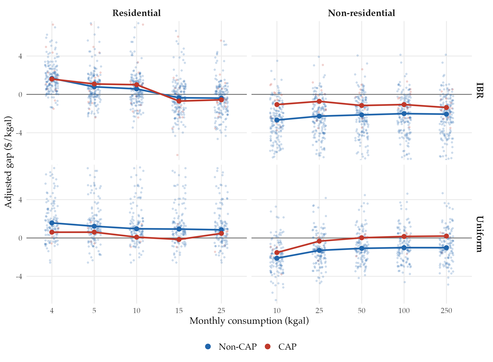
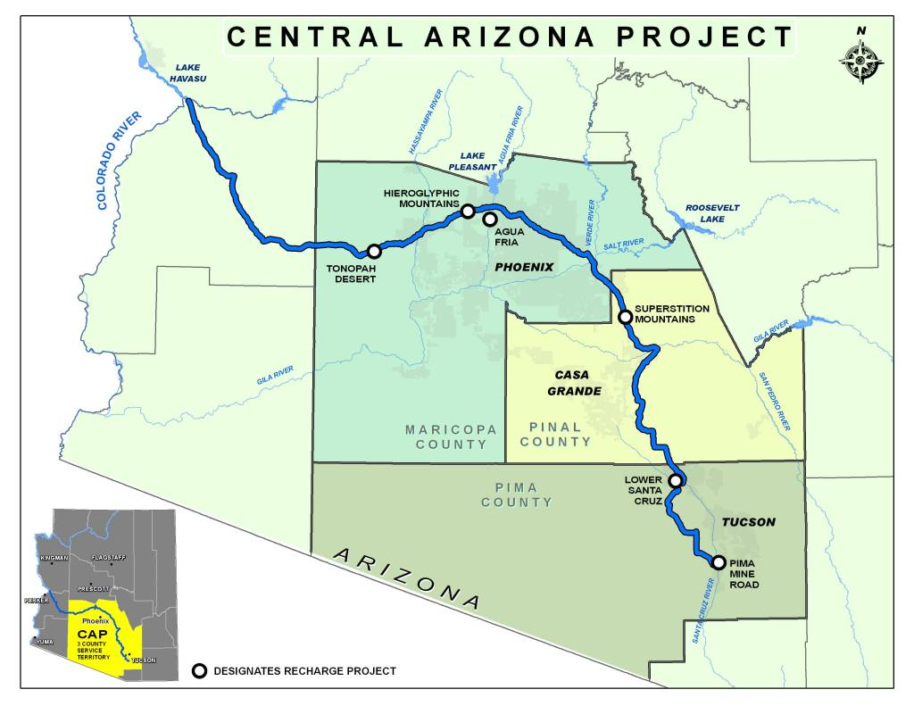
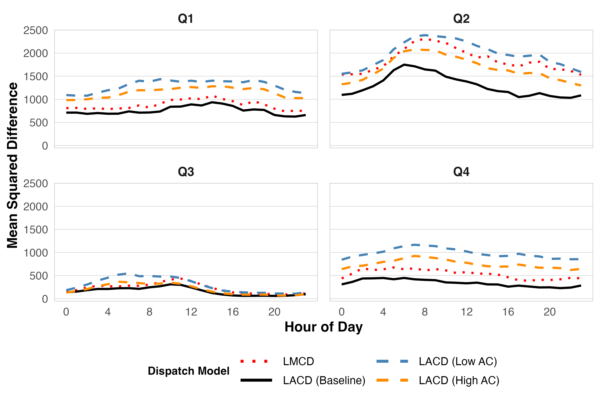
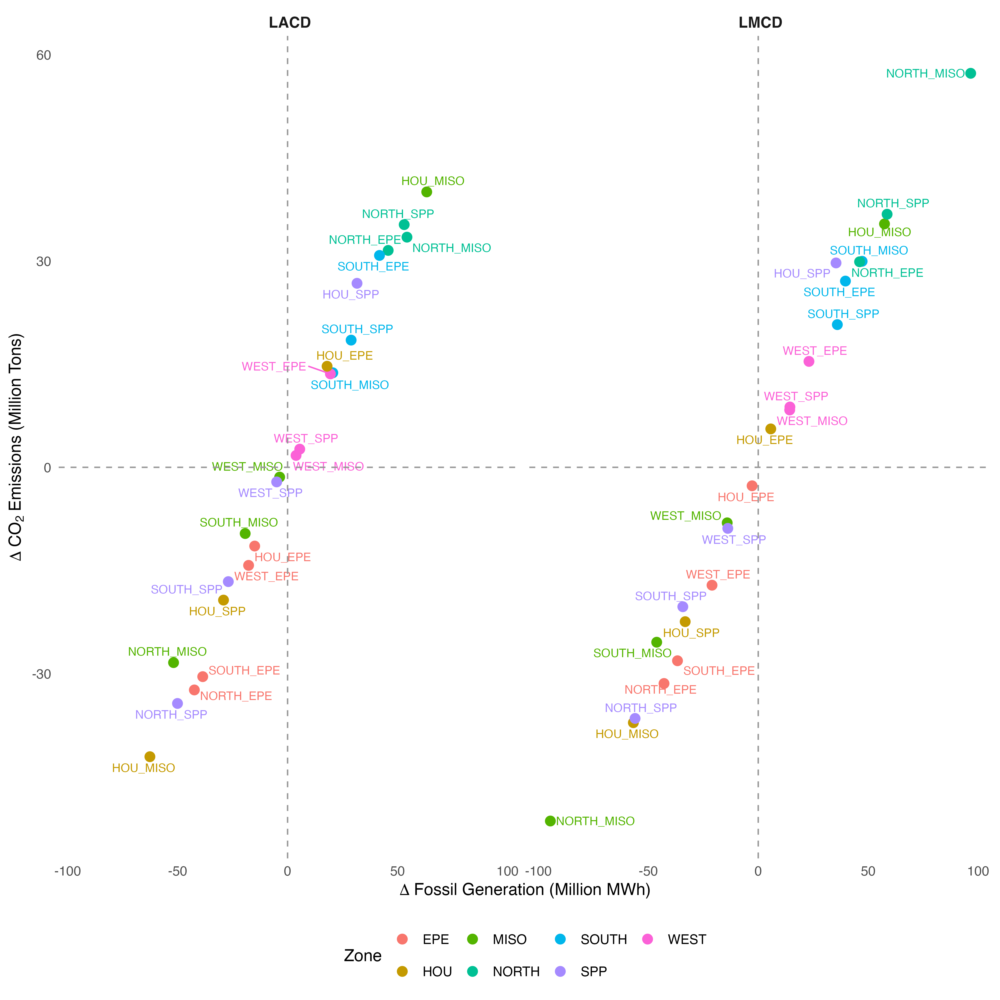
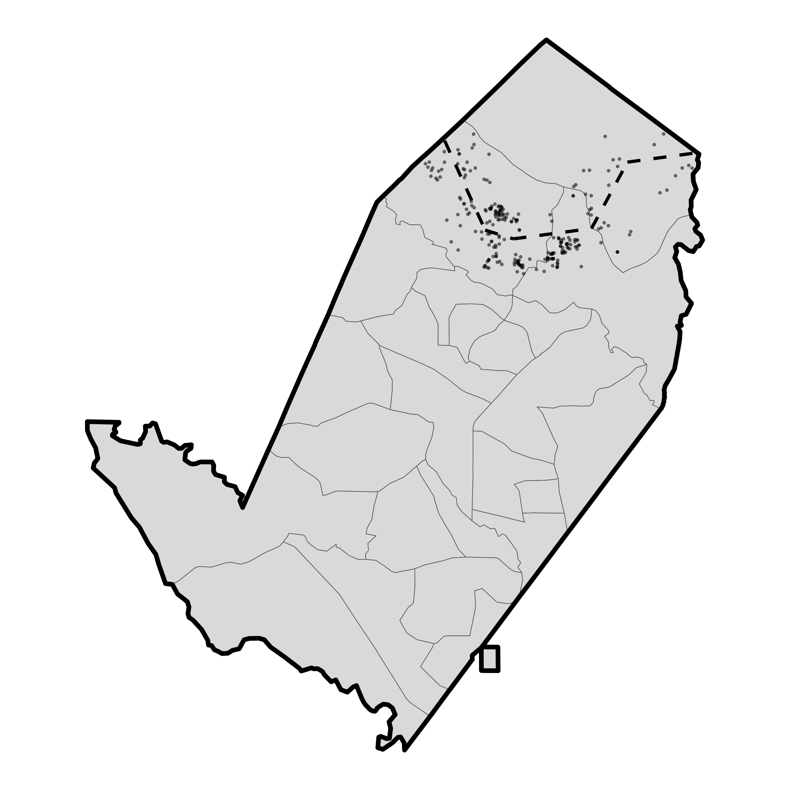
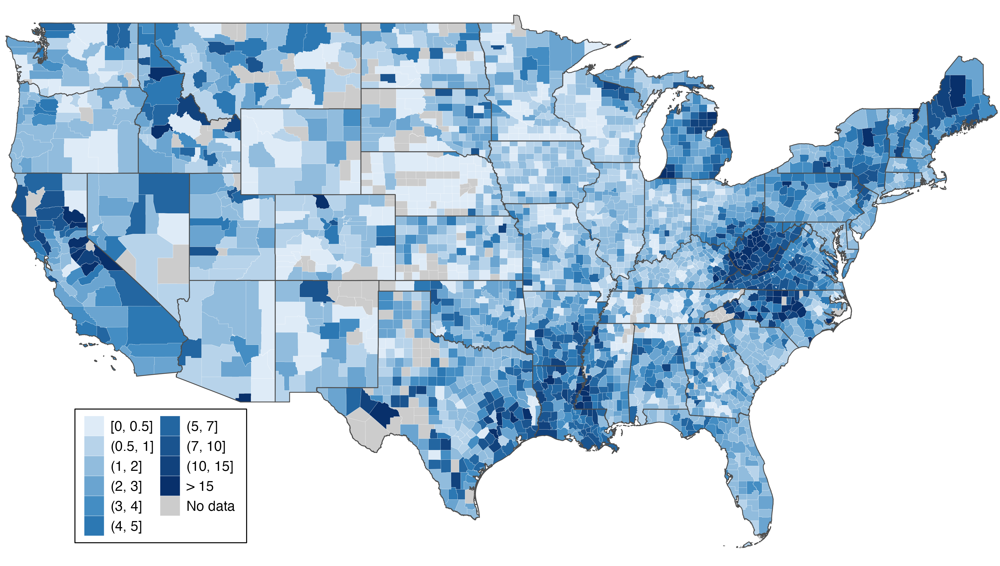

## Working Papers

### **Pricing Urban Water: Rate Structures and Scarcity Rents Under Supply Uncertainty** (with <a href="https://haslam.utk.edu/people/profile/charles-sims/" target="_blank">Charles Sims</a>) <a class="paper-btn" href="/files/AZ_Water_Pricing_NeffSims.pdf" target="_blank">Draft</a>

  
Abstract

  
Optimal pricing of scarce natural resources maximizes social welfare, yet public water utilities rarely price to reflect scarcity. We estimate residential and non-residential urban water demand using a new panel of Arizona utilities. We apply these elasticities to a dynamic Ramsey pricing model with uncertain supply and document how far prices fall below the scarcity-inclusive optimum. We find that residential rates fall well below the optimum at low-to-moderate consumption while non-residential rates tend to be above. Moving the utilities that buy Colorado River water to efficient prices cuts their draw on the river by 14 to 17 percent and raises welfare by roughly $21 million annually under normal conditions and $38 million under sustained shortage. The transition is financed almost entirely through bill increases for moderate-use residential customers while low-use and commercial bills change little. We argue that this asymmetry offers a structural explanation for why efficient water pricing remains politically difficult.

  
  

---

### **Lone Star Grid: The Impact of Texas Electricity Interconnection** (with <a href="https://haslam.utk.edu/people/profile/scott-holladay/" target="_blank">J. Scott Holladay</a>) <a class="paper-btn" href="/files/Texas_Interconnection_NeffHolladay.pdf" target="_blank">Draft</a>

  
Abstract

  
Using a novel least average cost dispatch (LACD) algorithm, this paper evaluates the economic and environmental costs of Texas maintaining an isolated electricity grid. We build a structural model to characterize the supply of electricity and simulate counterfactual integration scenarios. We find that Texas's largest population zones connected with neighboring states to the East results in reductions of generation costs of $83M annually. We also show that accounting for fixed costs in the dispatch model allocates generation to units with lower average fixed costs than under least marginal cost dispatch. This change in allocation along the margin results in large differences in emissions impacts. Tracing each plant's emissions through a tract-level air quality model, we find that most interconnection scenarios raise population-weighted PM2.5 exposure, because generation shifts toward lower-cost coal and lignite units. Health damages rise by up to $249 million per year and exceed the generation cost savings in eight of twelve scenarios. In nine scenarios, PM2.5 rises for more than 90 percent of Texans. Revenue and generation shifts to Texas firms in nine of twelve scenarios. We also show that reductions in costs of maintaining reliability are as large or larger than generation cost reductions.

  
  

---

### **Valuing Power Outages: Evidence from U.S. Housing Transactions** (draft available upon request)

  
Abstract

  
Utilities and policymakers allocate billions of dollars to improve electricity reliability and grid resilience. I ask whether the capitalization of chronic reliability into home prices can be credibly identified with two different nationwide outage datasets and find that it cannot. The two sources disagree once mapped to a common geography. Validated against audited state regulatory filings, the widely used county outage data are a weak proxy for utility reliability. The naive county panel does return a statistically significant outage coefficient, but it is economically negligible, near twelve dollars per outage hour for the median home. Across designs measured at their native geography, I find no economically meaningful capitalization of chronic reliability, and the transaction hedonic bounds the contemporaneous response within a few hundredths of a percent per outage hour.

  

    
    
Utility service boundaries, Atlanta metro

  

  

    
    
Mean minor-event outage duration by county

  

---

## Works in Progress

### **Not All Delays Are Equal: Queue Management and the Spatial Efficiency of Renewable Energy Deployment** (with <a href="https://sites.google.com/view/npinsonneault/homepage" target="_blank">Nicolas Pinsonneault</a>)

### **Costs of Low Quality Power** (with <a href="https://sites.google.com/view/finbarcurtin/home" target="_blank">Finbar Curtin</a>)
